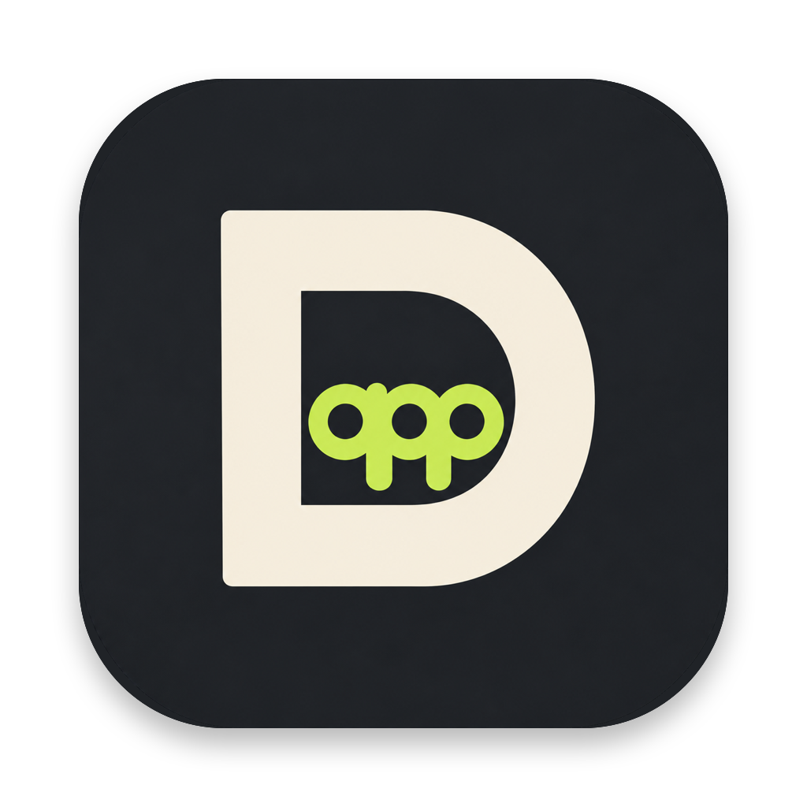

<p align="center">
  
</p>

<h1 align="center">Default App</h1>

<p align="center">
  <b>A modern, lightning-fast default application manager for macOS.</b><br>
  现代、原生、零后台常驻的 macOS 文件默认打开方式架构管家。
</p>

<p align="center">
  <a href="https://github.com/wood02/DefaultApp/releases"></a>
  <a href="LICENSE"></a>
  
  
  
</p>

---

## 简体中文

### 💡 为什么需要 Default App？

从 macOS Ventura 到 Sequoia、最新 macOS，系统自带的「显示简介 > 始终以此方式打开」操作繁琐，且经常遇到修改后系统不生效、无法批量管理扩展名、或误关联的问题。

**Default App** 是专为 macOS 设计的现代化原生默认应用管理器（完美替代已停止维护的 Bandisoft DefaultAppChanger）：
- **全格式双向透视**：既能查看某款 App 支持的所有文件类型，也能通过某个后缀直查当前由谁接管；
- **智能预判与一键批量**：自动检测哪些格式尚未生效，支持勾选保存与「⚡︎ 一键绑定所有格式」；
- **常用格式专栏**：内置代码（py、js、ts、json、sh 等）、音视频、图片、压缩包等 60+ 种高频格式，告别翻找；
- **100% 原生轻量**：纯 Swift 6 + SwiftUI 编写，直接调用 Apple CoreServices LaunchServices 底层接口，**零常驻后台、零守护进程、零资源占用**。

---

### ✨ 核心特性

- 🎯 **应用中心 (By-App Inspector)**
  - 自动扫描 Mac 上安装的所有应用程序及其支持的 UTI 与扩展名。
  - 智能显示「支持格式数」与「已默认生效数」对比进度。
  - 支持按「全部格式」、「已生效」、「未关联」及「常用格式」四个维度快速过滤。
- 🔍 **格式直查 (Extension Lookup)**
  - 输入任意扩展名（如 `.pdf`、`.png`、`.ts`），即刻查明当前生效的打开应用。
  - 列出系统内支持该格式的所有备选候选者，一键切换接管应用。
- ⚡️ **智能防呆与自动同步**
  - 设置默认应用时，系统会弹出系统原生确认授权框；
  - 软件内置 LaunchServices 数据库智能轮询刷新机制，点击确认后状态自动秒级同步，无需手动重启或刷新。
- 🍎 **全平台架构支持**
  - 采用通用二进制构建（Universal 2），原生支持 Apple Silicon（M1/M2/M3/M4 系列）与 Intel x86_64 Mac。
  - 适配 macOS 12 Monterey、13 Ventura、14 Sonoma、15 Sequoia 及更高版本。

---

### 📦 安装方式

#### 方式一：直接下载发布包（推荐）
前往 [GitHub Releases](https://github.com/wood02/DefaultApp/releases) 下载最新的 DMG 或 ZIP 安装包：
1. 双击打开 `Default-App-v0.0.1-macOS-Universal.dmg`；
2. 将 **Default App** 拖入 `Applications` 文件夹即可直接运行。

#### 方式二：源码一键构建
本工程无需额外第三方依赖，使用系统自带的 Xcode Command Line Tools 即可秒级编译：
```bash
# 克隆仓库
git clone https://github.com/wood02/DefaultApp.git
cd DefaultApp

# 一键编译并安装到 /Applications
make install
```

---

## English

### 💡 Why Default App?

Managing file associations on modern macOS (Ventura, Sonoma, Sequoia and beyond) through the native "Get Info > Open with" dialog is slow, tedious, and often fails to persist across system updates.

**Default App** is a modern, lightweight, native file association manager designed to replace outdated tools:
- **Bi-directional Association Inspector**: Inspect all file formats claimed by any app, or lookup who owns a specific extension in real time.
- **Batch Setup & One-Click Bind**: Automatically identifies unassociated extensions and binds all claimed formats with a single click.
- **Common Extensions Category**: Curated list of 60+ essential formats (code, developer tools, audio, video, images, archives).
- **Pure Swift & SwiftUI**: Direct integration with Apple's `CoreServices.LaunchServices` API. **Zero background daemons, zero battery drain**.

---

### 🛠 Build from Source

```bash
# Build universal binary in build/
make build

# Package releases into dist/ (.dmg & .zip)
make release

# Clean build artifacts
make clean
```

---

### 📄 开源许可证 (License)

本项目采用 [MIT License](LICENSE) 授权开源。欢迎提出 Issue 或 Pull Request 共建！

Author: **wood02** (2026)
